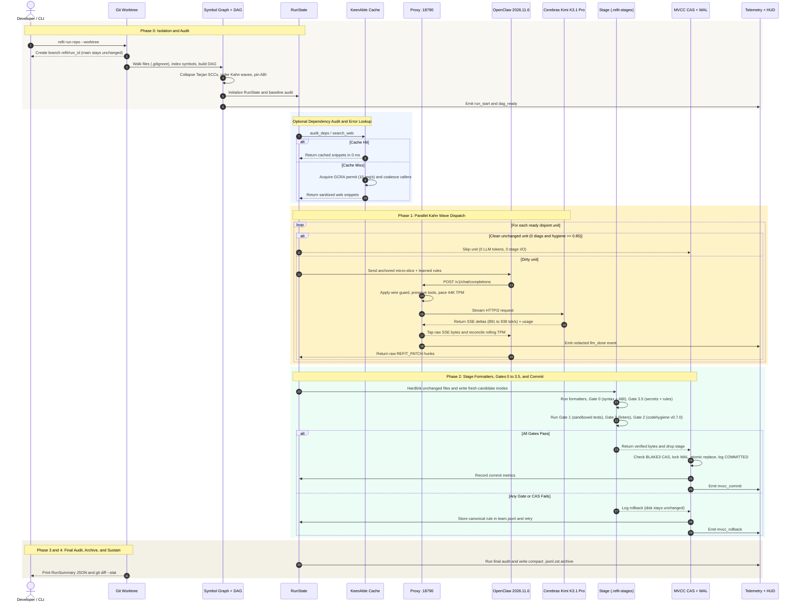

# refit v0.5.0

`refit` is a pure-Rust polyglot refactoring and untangling engine. It runs with **Cerebras Kimi K3.1 Pro**, **unpatched OpenClaw `2026.11.6`**, and **KeenAble** web search.

- **Interactive Replay:** [patrickfield152-del.github.io/refit/?replay=run.jsonl](https://patrickfield152-del.github.io/refit/?replay=run.jsonl)
- **Single Stripped Binary (`9.02 MB`, Windows `x86_64`):** Builds on Linux, macOS, and Windows. Embeds `codehygiene v0.7.0` weights (`weights.npz`) with zero Node or Bun runtime.

## Execution Sequence



## Core Capabilities

1. **Phase 0 Audit (`refit audit`, `refit_audit`):** Detect cross-file clones, dead exported symbols, orphan files, large high-risk files, duplicate domain modules, unused dependencies (`package.json`, `Cargo.toml`, `pyproject.toml`, `go.mod`), and infra issues (Terraform, Dockerfiles, GitHub Actions, SQL).
2. **Exact Pure-Rust Hygiene (`src/hygiene.rs`):** Run the embedded `codehygiene v0.7.0` ternary neural model (`weights.npz`) in Rust. Achieves **`0.0000` max parity error** against `worker.mjs` with zero JS sidecar.
3. **Polyglot Symbol Graph and DAG (`src/stem.rs`, `src/graph.rs`):** Index Python, Rust, TypeScript/TSX, JavaScript, and Go with `.gitignore` filtering and test-code stripping. Collapse cyclic SCCs and dispatch disjoint Kahn waves.
4. **Structural Multi-File Patches (`src/graph.rs`, `src/mvcc.rs`, `src/mcp.rs`):** Support `edit`, `create`, `delete`, and `rename` patches inside atomic MVCC WAL transactions with OS file locks and crash recovery.
5. **Deterministic Formatters and Sandboxed Gates (`src/gates.rs`):** Run `ruff format`, `rustfmt`, `gofmt`, and `biome format` before Gates 0 to 3.5. Execute all subprocesses with `clear_env = true` and a minimal env allowlist.
6. **Hardened Proxy and Concurrent MCP (`src/proxy.rs`, `src/mcp.rs`):** Pace rolling uncached TPM with exact refunds, preserve deterministic tool schemas, enforce loopback CORS, and handle MCP tools concurrently (`refit_scan`, `refit_symbols`, `refit_audit`, `refit_sustain`, `refit_read`, `refit_apply`, `refit_verify`, `refit_resume`, `refit_search`, `refit_tx_*`).
7. **Phase 4 Sustain (`refit sustain`, `refit_sustain`):** Generate `AGENTS.md`, `.refit/invariants.yml`, `docs/ADR-001-untangle.md`, and `.github/workflows/refit-guard.yml`.

## Measured Results

| Check | Measured Evidence |
| :--- | :--- |
| Live Kimi K3.1 Pro probes (`moonshotai-kimi-k3.1-pro-trial`) | Probe 1 (`22:22 UTC`, Nov 22): `HTTP 200`, `50,000` uncached TPM, `1,000` RPM, `32.44 s` queue, `41 ms` prefill, **`891 tok/s`** decode. Probe 2 (`00:58 UTC`, Nov 23): `6.8 ms` queue, `11.6 ms` prefill, **`938 tok/s`** decode. Saved in [telemetry/kimi-probes.json](telemetry/kimi-probes.json). |
| Pure-Rust `codehygiene v0.7.0` parity | **`0.000000` max absolute delta** across all 10 benchmark files (`src/*.rs`, `engine.js`, `mod_*.py`, 2-space nested TS) vs `worker.mjs`. |
| Repo scan latency and RSS (`mimalloc`) | `refit scan . --fast`: **`345 ms` cold `--no-cache`** (`117.96 MB` peak RSS, `0` false Rust SCCs) and **`7 ms` warm (`11.21 MB` RSS)**. `fixture/target_repo --fast`: **`194 ms` cold (`16.79 MB` RSS)**, **`9 ms` warm (`11.45 MB` RSS)**, `62` units, `2` SCCs, `4` waves. |
| Concurrent MCP and Audit CLI | 5 concurrent MCP calls (`initialize`, `refit_scan`, `ping`, `refit_symbols`, `refit_audit`) finish in **`86.8 ms`**. `refit audit . --markdown` finishes in **`93.3 ms`**. |
| Unit and adversarial probes (`-D warnings`) | **`100 / 100` passed** with **`0` compiler warnings** in `3.27 s`. |
| Alternating OS CPU and RSS bench (`refit bench`) | Supports Python `--script` and generic polyglot `--cmd` templates with separate `cpu_ms` and `wall_ms` checks (`<= 1.05x`). |

## Quick Start

```bash
# Build and test with warnings denied
RUSTFLAGS="-D warnings" cargo test
RUSTFLAGS="-D warnings" cargo build --release

# Scan or audit a polyglot repository
./target/release/refit scan ./fixture/target_repo --fast
./target/release/refit audit ./your_repo --markdown
./target/release/refit sustain ./your_repo --dry-run

# Run parallel refactoring in an isolated git worktree
export CEREBRAS_API_KEY="csk-..."
export KEENABLE_API_KEY="keen_..."
./target/release/refit run ./your_repo --worktree --openclaw-url http://127.0.0.1:18789/v1
```

## Disclosures and Credits

- All local Rust metrics (`9.02 MB` binary, `0.000000` hygiene parity delta, `345 ms` cold / `7 ms` warm repo scan, `86.8 ms` concurrent MCP, `100/100` probes) and live Kimi K3.1 Pro probes (`891`–`938 tok/s`) were measured directly. The 64-module wave replay uses Kimi K3.1 Pro probe-calibrated mock wave data because `moonshotai-kimi-k3.1-pro-trial` returned `HTTP 404 model_not_found` after `01:02 UTC` (Nov 23).
- Public demos use standard unpatched **OpenClaw `2026.11.6`**.
- Credits: [`proxysoul/stem v0.4.0`](https://github.com/proxysoul/stem) and [`brianbell-x/codehygiene v0.7.0`](https://github.com/brianbell-x/codehygiene).
