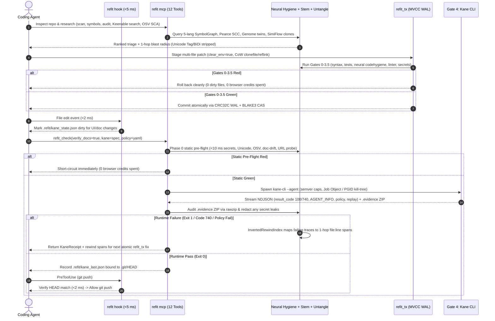
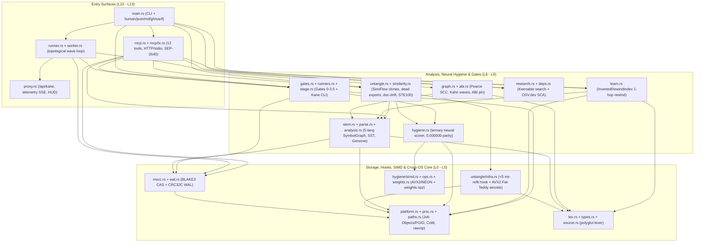

# refit

[](https://github.com/bevowoved/refit/actions/workflows/ci.yml)
[](https://crates.io/crates/refit)
[](#license--credits)
[](rust-toolchain.toml)

**`refit` works inside your coding agent loop and from your terminal or CI.**
One static Rust binary equips Claude Code, Cursor, Gemini CLI, Kiro, and Antigravity with local neural hygiene, symbol-graph untangling, web-wired MCP, and `<5 ms` hooks.
It pairs those local gates directly with **TestMu AI Kane CLI** for real browser and mobile proof.

> **Two-Tier Loop Engineering:** TestMu AI research reports that **81% of teams merged AI code they did not fully understand**. No agent harness can reliably audit itself. `refit` guides and verifies coding agents on every edit, then hands clean diffs to **TestMu AI Kane CLI** for independent runtime proof.

- **Live Gate 4 Site:** [bevowoved.github.io/refit/?demo=1&at=100&tab=kane](https://bevowoved.github.io/refit/?demo=1&at=100&tab=kane)
- **Crates.io:** [crates.io/crates/refit](https://crates.io/crates/refit) (`cargo install refit --locked`)
- **Agent Skill (`skills.sh` + SEP-2640):** [skills/refit/SKILL.md](skills/refit/SKILL.md) (`npx skills add bevowoved/refit --skill refit`)

---

## What `refit` Gives Coding Agents (and Standalone CLI)

One `12.71 MiB` binary replaces six separate tools inside the agent loop or CI, with zero active Cargo duplicates.

| Layer | Local Capability | Ecosystem Lineage |
| :--- | :--- | :--- |
| **Neural Hygiene & Deslop** | Embedded ternary `codehygiene` (`weights.npz`, `0.000000` parity), strict rules, and complexity scoring (`median=0.845`) | [`brianbell-x/codehygiene`](https://github.com/brianbell-x/codehygiene), [`bevowoved/codehygiene`](https://github.com/bevowoved/codehygiene) |
| **`stem` SymbolGraph & Rewind** | 5-language lexer (Py/Rs/TS/JS/Go), Zstd SST + Bloom index, Pearce SCC cycles, Kahn waves, and 1-hop failure rewind | [`proxysoul/stem`](https://github.com/proxysoul/stem) |
| **Untangle & Doc Truth** | Cross-file `SimiFlow` Type-2 clones, `Genome` co-change twins, dead exports, unused deps, README `--verify-docs`, and ASD-STE100 linting | Clean-room `untangle-codebase`, `Genome`, `SimiFlow`, `ASD-STE100` |
| **Web-Wired 12-Tool MCP** | **12 annotated tools** (`stdio` + stateless HTTP), keyless Keenable `refit_search`, OSV.dev SCA, and SEP-2640 `skill://refit/SKILL.md` | [Keenable](https://api.keenable.ai/mcp-public), [OSV.dev](https://osv.dev/), [skills.sh](https://skills.sh/), [OpenClaw](openclaw/openclaw.refit.json) |
| **Event Hooks & Secret Shield** | `<5 ms` `refit hook` for Claude Code, Cursor, Gemini CLI, and Kiro with dirty-UI tracking, Unicode defense, and `0.54 ms` secret scans | [`mongodb/kingfisher`](https://github.com/mongodb/kingfisher), [`gitleaks/gitleaks`](https://github.com/gitleaks/gitleaks) |
| **Atomic MVCC Staging** | `refit_tx` isolated stages (`clear_env=true`) with BLAKE3 CAS and hardware CRC32C WAL (`src/mvcc.rs`) | Pure-Rust MVCC WAL |
| **Gate 4 Kane CLI Proof** | Static short-circuit (`0` credits on red), `--agent` NDJSON (`100` / `"740"`), `--policy` gates, `.evidence` secret audit, and `0`-credit replay | [`LambdaTest/kane-cli`](https://github.com/LambdaTest/kane-cli) + TestMu AI Hosted MCP |

---

## Quick Start (60 Seconds)

1. Install the binary and agent skill.

```bash
cargo install refit --locked
npx skills add bevowoved/refit --skill refit
```

2. Wire Git hooks, agent hooks, `AGENTS.md`, and `.refit/invariants.yml` in one command.

```bash
refit init .
```

3. Connect `refit` (`12` local tools) with TestMu AI Hosted MCP (`6` tools). Together they use `18 / 100` Antigravity slots (Playwright MCP uses `92`).

```json
{
  "mcpServers": {
    "refit": { "command": "refit", "args": ["mcp", "."] },
    "testmu-ai": { "serverUrl": "https://mcp.lambdatest.com/mcp" }
  }
}
```

4. Run local structural checks (zero API keys, offline-safe) or add `--kane` for live browser proof.

```bash
# Structural hygiene, clones, cycles, and README doc-drift (offline, 0 credits)
refit audit . --markdown
refit check . --verify-docs --format human

# Gate 4 live Kane CLI verification with declarative policy and 0-credit cached replay
refit check . --verify-docs \
  --kane tests/kane/hud_mobile_viewport_test.md \
  --policy tests/kane/refit-policy.yaml \
  --format human
```

Enable the `<2 ms` push gate by setting `REFIT_KANE_GATE=1` (or adding `.refit/kane.json`). `refit hook` tracks UI and doc edits on `PostToolUse`, `AfterTool`, `afterFileEdit`, and `fileEdited`, then blocks `git push` until `.refit/kane_last.json` matches `.git/HEAD`.

---

## How `refit × Kane CLI` Works

### 1. Closed-Loop Verification Sequence



### 2. Acyclic Module Structure (`47` `.rs` Files, `0` SCC Cycles)



---

## Live TestMu AI Kane CLI Proof

Every run below executed against the live HUD at `https://bevowoved.github.io/refit/?demo=1&at=100&tab=kane`:

- **Red Run (Exit `1`):** Caught an injected UI cycle-handler regression in Chrome while all `114` Rust tests stayed green. [Cloud Report](https://test-manager.lambdatest.com/projects/01M8CCK3HA4AXTYRJCKDBE2CXY/test-cases/01M8CEN7WZWRWEQ604GT7MJ6FW/dashboard/share/US_4KSHZBGFZ41JKBN8YR1L1H6FI8EREXRKJ9UZ597AW95EI2N7A0XUEOEF8ZGW1EB1?type=summary&agentView=true&fqdn=summary-page) · [NDJSON](tests/kane/runs/red-run.ndjson)
- **Policy & `.evidence` Audit:** Failed declarative `refit-policy.yaml`, audited `failure.yaml` inside the sealed `.evidence` ZIP (`0` secret leaks), and rewound `13` files. [Cloud Report](https://test-manager.lambdatest.com/projects/01M8CCK3HA4AXTYRJCKDBE2CXY/test-cases/01M8CEWA1F5DKEEY3QMXFCC6W3/dashboard/share/US_X7ZDGRM4VIFTRAFYL69VKO6DOHP811WOXG9FTXYJYDMUVVVMRVBMKQ4HNTILRNEO?type=summary&agentView=true&fqdn=summary-page)
- **Green Run (Exit `0`):** Verified the live site (`verdict: "passed"`, `0` static secrets in `7 ms`) and archived a validated `1.95 MB` fallback pack at [docs/evidence/refit-hud-verified.evidence](docs/evidence/refit-hud-verified.evidence). [Cloud Report](https://test-manager.lambdatest.com/projects/01M8CCK3HA4AXTYRJCKDBE2CXY/test-cases/01M8CFGKD2V1KJECDJ20ZDVYZ8/dashboard/share/US_QSIMKC2608G5T2JKFG18SK3T3TG0H75A16056KSPCAFXTK2QA3UH7O6ZUQMVKLEX?type=summary&agentView=true&fqdn=summary-page)
- **Cached Replay (Exit `0`, `0` LLM Author Steps):** Replayed `tests/kane/hud_mobile_viewport_test.md` with `--policy tests/kane/refit-policy.yaml --no-adaptive-heal` (`1` replay / `0` author steps, `policy_verdict: pass`). [Receipt](tests/kane/runs/green-replay-0cr.json)

---

## Cross-OS Support (macOS Apple Silicon · Linux · Windows · WSL2)

`refit` builds and passes `clippy -D warnings`, `114/114` unit + E2E tests, and `8/8` `T14` mutation checks on all three desktop OS targets.

| Platform | Allocator & SIMD | Sandbox & Stage Acceleration | Gate 4 Kane CLI Web + Mobile |
| :--- | :--- | :--- | :--- |
| **macOS Apple Silicon** (`aarch64-apple-darwin`) | `mimalloc` + NEON neural and secret paths | POSIX PGID kill-tree + **APFS `clonefile`** CoW stages | Local Chrome + **local iOS Simulator & Android Emulator** + TestMu Cloud `--remote` |
| **Linux x64** (`x86_64-unknown-linux-gnu`) | `jemalloc` (`17.57 MiB` MCP RSS) + AVX2 Fat-Teddy | POSIX PGID kill-tree + Btrfs/XFS reflink CoW stages | Local headless Chrome + TestMu Cloud `--target android\|ios --remote` |
| **Windows x64 & WSL2** (`x86_64-pc-windows-msvc`) | `mimalloc` + AVX2 Fat-Teddy (`0.54 ms` / 10K LOC) | **Win32 Job Objects** kill-tree + atomic `ReplaceFileW` | Local Chrome DevTools + TestMu Cloud `--target android\|ios --remote` |

## Honest Limits

- Static neural hygiene and graph checks run in milliseconds (`0` credits), but they cannot see rendered DOM or CSS.
- First-time browser authoring takes `30-120s`. Cached `_test.md` replays run at `0` LLM author steps after the first pass.
- Sealed `.evidence` ZIPs stay unredacted for audit fidelity. `refit` scans them before commit and keeps `.testmuai/evidence/` gitignored.
- Local iOS and Android emulators require macOS Apple Silicon. Windows and Linux route mobile specs ([tests/kane/mobile_cloud_example.md](tests/kane/mobile_cloud_example.md)) to TestMu Cloud (`--remote`).

---

## Measured Benchmarks

| Metric | Measured Value | Check |
| :--- | :--- | :--- |
| Static binary size | **`12.71 MiB`** (`--release --features full`) · **`10.81 MiB`** (`--profile dist`) | Single binary with embedded `weights.npz` |
| Source & crate hygiene | **`47 / 48`** `.rs` files · **`0`** active Cargo duplicates | `S3` self-audit + `cargo tree --duplicates` |
| Neural hygiene parity | **`0.000000`** max delta (`median 0.845`, `p10 0.821`) | `S4` exact SIMD + scalar parity |
| Real-repo cold scan | **`79 ms`** (`gin`) · **`346 ms`** (`hono`) · **`1.04 s`** (`uv`) | `refit scan --no-cache` |
| Secret pre-flight | **`0.54 ms`** (10K LOC) · **`8.85 ms`** (400K LOC) · **`0.24 ms`** (warm) | 2-slab AVX2 Fat-Teddy + BLAKE3 cache |
| 1-vCPU Peak RSS (`jemalloc`) | **`17.57 MiB`** (`mcp`) · **`27.34 MiB`** (`scan`) · **`29.71 MiB`** (`audit`) | Warm `56.95 ms`, sustain `27.67 ms` |
| Verification gates | **`114/114`** tests · **`8/8`** `T14` mutants · **`0`** clippy/SCC/clone/doc-drift | Cross-OS `cargo xtask verify && mutate` |

Inline allow comments support `gitleaks:allow`, `pragma: allowlist secret`, `trufflehog:ignore`, and `refit:ignore`.

## Install, Commands & Feature Flags

```bash
# Install from crates.io, cargo-binstall, or source
cargo install refit --locked
cargo binstall refit
cargo install --path . --locked --features full

# Verify GitHub Release SLSA Level 3 provenance and checksums
gh attestation verify refit-<target>.<ext> --repo bevowoved/refit
sha256sum -c --ignore-missing SHA256SUMS.txt

# Everyday CLI commands
refit scan . --fast                            # neural codehygiene, Stem graph, DAG waves
refit audit . --markdown --ste100              # cycles, clones, Genome twins, doc-drift, STE100
refit check . --staged --deps --verify-docs    # secrets, Unicode, OSV SCA, doc-drift, Kane CLI
refit hook                                     # <5 ms stdin-JSON agent hook
refit mcp . [--http 127.0.0.1:18791]           # 12-tool MCP server (stdio or stateless HTTP)
refit learn . --rewind my_symbol               # 1-hop SymbolGraph failure rewind
refit sustain . --dry-run                      # preview AGENTS.md, invariants, ADR-001, CI
refit gc .                                     # prune CAS blobs, stages, and caches
cargo xtask verify && cargo xtask mutate       # full S1-S14 and T14 mutation suite
```

| Feature Flag | Purpose |
| :--- | :--- |
| `alloc-mimalloc` (default) / `alloc-jemalloc` | Select `mimalloc` (default) or `tikv-jemallocator` (non-MSVC) |
| `wal-crc32c` · `sst-storage` · `build-cache` | Hardware CRC32C WAL, Zstd symbol SST + Bloom, and CoW reflink stages |
| `live-rewind` · `doc-drift` · `ste100` | 1-hop SymbolGraph rewind, README drift checks, and ASD-STE100 linting |
| `full` | Enable all six feature flags above |

## License & Credits

Dual-licensed under **`MIT OR Apache-2.0`**.

- [`proxysoul/stem`](https://github.com/proxysoul/stem) — polyglot symbol graph and SST index design
- [`brianbell-x/codehygiene`](https://github.com/brianbell-x/codehygiene) & [`bevowoved/codehygiene`](https://github.com/bevowoved/codehygiene) — ternary neural code hygiene (`weights.npz`)
- [`LambdaTest/kane-cli`](https://github.com/LambdaTest/kane-cli) — TestMu AI Kane CLI Gate 4 browser and mobile verification
- [`mongodb/kingfisher`](https://github.com/mongodb/kingfisher) (Apache-2.0) & [`gitleaks/gitleaks`](https://github.com/gitleaks/gitleaks) (MIT) — secret pattern ecosystems
